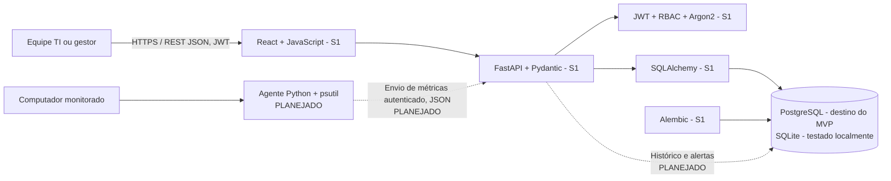
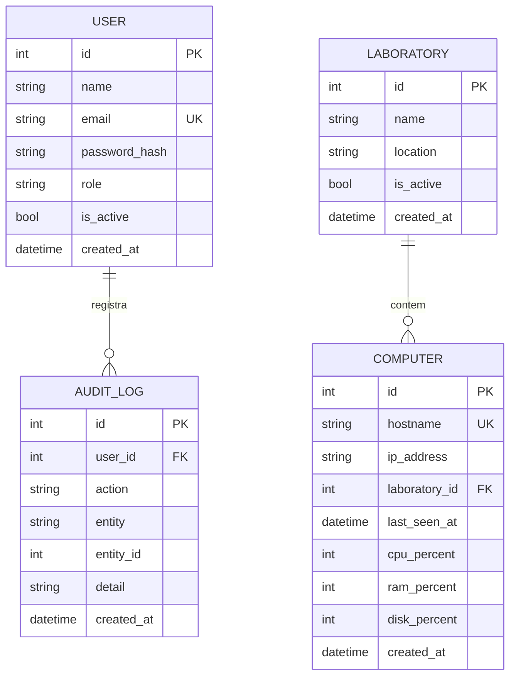

# Arquitetura greenfield — semana 1 (realizada) e MVP (projetada)

**Fonte principal:** capítulo 2, especialmente seções 2.1–2.7 da monografia UMC anexada. **Greenfield:** desenho arquitetural independente e organização modular nova; nesta entrega, o ponto de partida do código foi o ZIP V0.1 fornecido, não uma migração literal de repositório antigo. **Status:** somente componentes marcados «S1» foram implementados/testados nesta entrega.

## Visão de componentes

**Atenção:** o fluxo tracejado do agente é **planejado** (não existe endpoint de telemetria neste pacote). A confirmação de PostgreSQL, TLS, Hyper-V e Windows Server depende de instalação externa. A arquitetura preserva os cinco elementos do capítulo 2.

## Modelo de dados S1 (implementado)

**Integridade:** `Computer.laboratory_id` tem FK NOT NULL com `ondelete=RESTRICT`; a aplicação retorna HTTP 409 antes de exclusão de laboratório ocupado; isso também impede apagar computadores por cascata. Campos de telemetria nullable da tabela `computers` **não são histórico** e permanecem nulos sem agente. A migração inicial cria quatro tabelas e índices, sem INSERT.

## Separação de responsabilidades

- **Frontend:** `frontend/src/App.jsx` consome endpoints `/api/v1/*` usando `fetch` e token JWT; estados vazios são mostrados sem mocks. Layout em `styles.css`.
- **API:** `backend/app/main.py` expõe recursos e aplica RBAC. Endpoints aceitam/emitem JSON e valores validados por Pydantic.
- **Autenticação:** `backend/app/security.py` verifica hash Argon2, assina/verifica JWT e rejeita usuários inativos.
- **Domínio:** `backend/app/logic.py` calcula status de computadores com registro, mantém `iie:null` até validação de metodologia e monta resumo SQL.
- **Persistência:** `models.py`, `db.py`, Alembic; PostgreSQL é a opção especificada na monografia, SQLite é testado separadamente.
- **Auditoria:** tabela `audit_logs`; login e ações de escrita registram usuário, entidade, ação e instante.
- **Fase posterior:** agente `psutil`, recebimento de métricas, histórico temporal, alertas e IIE; não confundir objetivo previsto com software entregue.

## Interfaces REST da Semana 1

| Método | Rota | Acesso | Resposta principal |
|---|---|---|---|
| POST | `/api/v1/auth/login` | público | 200 token; 401 senha inválida; 403 usuário inativo |
| GET | `/api/v1/auth/me` | autenticado | 200 usuário; 401 sem sessão |
| GET/POST | `/api/v1/laboratorios` | leitura todos; POST admin/técnico | 200/201 |
| GET/PUT/DELETE | `/api/v1/laboratorios/{id}` | leitura todos; PUT admin/técnico; DELETE admin | 200/204; **409 ocupado** |
| GET/POST | `/api/v1/computadores` | leitura todos; POST admin/técnico | 200/201 |
| GET/PUT/DELETE | `/api/v1/computadores/{id}` | leitura todos; mutação admin/técnico | 200/204; 409 duplicado |
| GET/POST/PATCH | `/api/v1/users[/{id}]` | admin | 200/201 |
| GET | `/api/v1/auditoria` | admin | 200/403 |
| GET | `/api/v1/dashboard` | autenticado | JSON do banco; `iie:null` |
| GET | `/health` | público | conexão SQL testada |

## Decisões registradas (ADR)

- **ADR01:** sem seed automático; banco inicialmente vazio; bootstrap manual.
- **ADR02:** sem exclusão em cascata para computadores; aplicação impede com HTTP 409.
- **ADR03:** estados `sem_coleta`, `offline`, `online`, `atencao`, `critico` são distintos; `sem_coleta` não entra no denominador de disponibilidade.
- **ADR04:** não inventar IIE antes da definição matemática e validação acadêmica.
- **ADR05:** sem implementação de integração acadêmica, aplicativo móvel ou IA nesta versão, por delimitação da seção 1.4.
